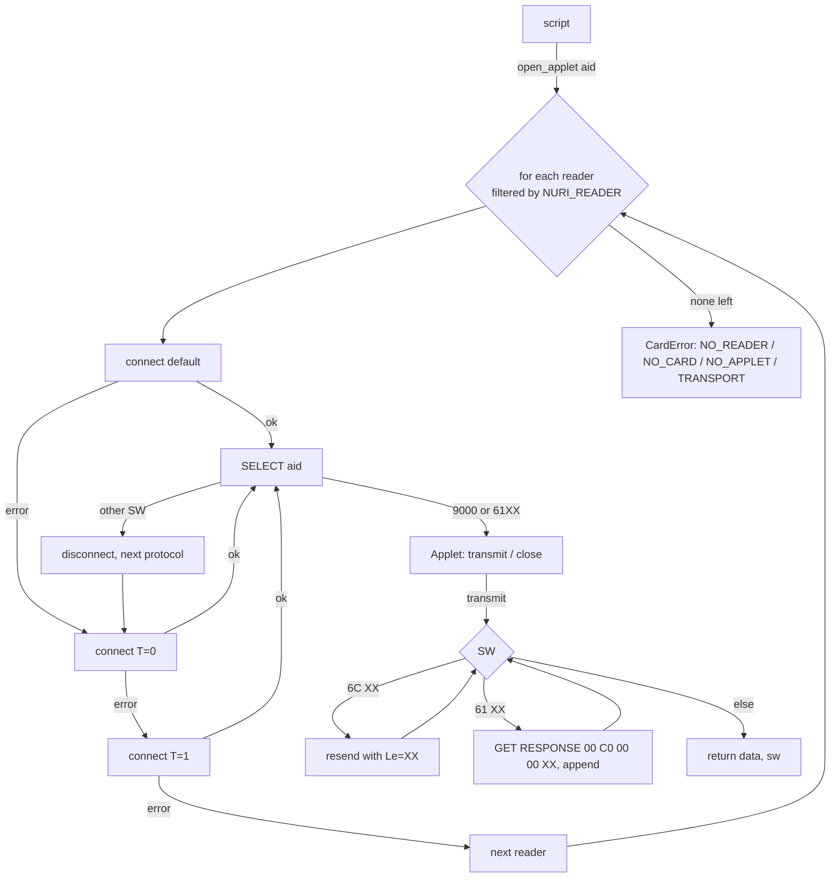

# Reader compatibility (PC/SC)

The Nuri card is a contact JavaCard (NXP JCOP4, ATR `3b119580`). It talks T=0 and
T=1, but not every reader negotiates both. This page records what was measured,
how every script now connects, and how to pin the behaviour.

## Finding

Measured by Emin on 2026-10-17 with the real card in both readers (the numbers
below are pcsc-lite error codes as pyscard reports them):

| Reader | pyscard default connect (T0\|T1) | `T1_protocol` | `T0_protocol` | Status |
|---|---|---|---|---|
| HID OMNIKEY 5422 (contact slot) | works | not needed | works | hardware-proven |
| Realtek "Generic Smart Card Reader Interface" (USB `0bda:0165`) | fails: card "unresponsive" `0x80100066` | fails: protocol mismatch `0x8010000F` | works | hardware-proven |
| fake readers in `test/test_nuri_pcsc.py` (same two shapes) | as above, simulated | as above, simulated | as above, simulated | fake-tested only |

On T=0 the card answers two procedure bytes that T=1 hosts never see:

- `61 XX` → the response is waiting; fetch it with GET RESPONSE `00 C0 00 00 XX`
  (the ETH SIGN answer comes back as `61 41` + GET RESPONSE, 65 bytes `r||s||v`).
- `6C XX` → wrong Le; resend the same header with `Le = XX`
  (ETH `80 01 00 00 00` → `6C 07`, `80 02 00 00 00` → `6C 21`).

Before this change every script carried its own copy of some of this logic
(`card-eth-test.py` forced T=0, `pkcs11-helper.py` had a one-level `card_tx`,
`ssh-pcsc-sk-helper.py` monkeypatched python-fido2 inline, the MuSig2 scripts
used the default connect only and therefore never found the card on the
Realtek reader). python-fido2's `CtapPcscDevice.connect()` (`fido2/pcsc.py`,
`self._conn.connect()` then `self._select()`) uses the default connect, so on the
Realtek reader `CtapPcscDevice.list_devices()` yields nothing and the FIDO2
scripts reported "No PC/SC FIDO2 smartcard device found" / ssh-sk "device not
found".

## One shared helper: `scripts/nuri_pcsc.py`



API (contract C1):

```python
import nuri_pcsc

applet = nuri_pcsc.open_applet("4E55524945544801")   # ETH applet
applet.reader_name, applet.protocol                   # e.g. 'Generic Smart Card Reader Interface', 'T0'
data, sw = applet.transmit(bytes.fromhex("8001000000"))  # (b'\x01\x03\x01ETH1', 0x9000)
applet.close()

nuri_pcsc.patch_fido2()   # then fido2.pcsc.CtapPcscDevice.list_devices() uses the ladder
```

- `transmit` never raises on a non-`9000` status word; callers decide.
- `CardError.code` is `NO_READER` (no reader at all, or none matching the
  filter), `NO_CARD` (readers but no card), `NO_APPLET` (card answered but the
  SELECT failed on every protocol), `TRANSPORT` (connect failed on every
  protocol with a card present). Across readers the most specific code wins.
- `patch_fido2()` is idempotent and keeps python-fido2's own `_select()` so U2F /
  CBOR capability detection is unchanged.
- pyscard and python-fido2 are imported lazily inside functions: the module
  imports without them, which is what the fake-reader tests rely on.

Scripts switched to it: `card-eth-test.py`, `card-totp.py`, `pkcs11-helper.py`,
`card-dashboard-server.py`, `card-cosign-tweaked.py` (and through its `Card`
class `read-musig2-card-key.py`, `real-card-arkade-signer-proof.py`,
`card-arkade-claim-signer.py`), `real-card-cosign-proof.py`,
`ssh-pcsc-sk-helper.py`, and the FIDO2 scripts `test-real-fido2-card.py`,
`direct-ctap-diagnostics.py`, `manage-fido2-pin.py`, `card-prf-backup.py`,
`reset-real-fido2-card.py` (all call `patch_fido2()` before `list_devices()`).
APDUs and AIDs are unchanged.

## Environment variables

| Variable | Values | Effect |
|---|---|---|
| `NURI_READER` | substring of a reader name, e.g. `OMNIKEY` or `Generic` | only readers whose name contains it are tried (`open_applet(..., reader=...)` overrides) |
| `NURI_PCSC_PROTOCOL` | `auto` (default), `T0`, `T1`, `default` | `auto` = ladder default → T0 → T1; anything else pins exactly one connect mode |

Examples:

```sh
NURI_READER=Generic scripts/run-card-python.sh scripts/card-eth-test.py
NURI_PCSC_PROTOCOL=T0 npm run card:pin:status
```

## Tests

`npm run test:pcsc` (CI: `card-release` job runs `python3 -m unittest discover
-s test -p test_nuri_pcsc.py -v`) runs `test/test_nuri_pcsc.py` with fake
pyscard readers and connections; no hardware is touched. The fakes model the
measured behaviour of both readers (default connect raising "unresponsive",
T=1 raising "protocol mismatch", T=0 answering `61XX` / `6CXX`), the error
codes, the env filters, the python-fido2 patch (against a stand-in
`fido2.pcsc` module shaped like python-fido2 2.x), and the switched scripts'
card classes end-to-end against the Realtek-shaped fake.

What the fakes do **not** prove: real pcsc-lite behaviour on macOS, the
OMNIKEY contactless slot, or any reader not in the table. Those rows stay
`UNVERIFIED` until someone runs the real-card commands below on them.

## Real-card verification (parent / Emin only)

```sh
ssh -o BatchMode=yes nuri.com true && echo SSH_OK      # ssh-pcsc-sk-helper.py via patch_fido2()
npm run card:pin:status                                   # manage-fido2-pin.py → list_devices() after patch_fido2()
scripts/run-card-python.sh scripts/card-eth-test.py       # ETH read-only: version, existing pubkey, 6989 guard, sign+verify, MuSig2 RNG check
NURI_READER=Generic scripts/run-card-python.sh scripts/card-eth-test.py   # force the Realtek reader
npm run card:totp -- status                               # TOTP SELECT through the ladder
```

Expected on the Realtek reader: `Reader: Generic Smart Card Reader Interface (protocol T0)`;
on the OMNIKEY: `(protocol default)`. Never pass `--regenerate` to
`card-eth-test.py` on a keyed card (one-shot KEYGEN, answers `6989`).
